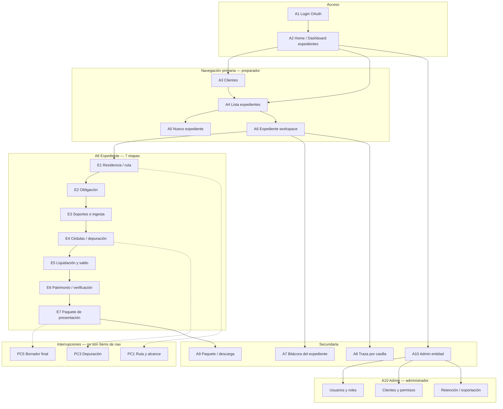
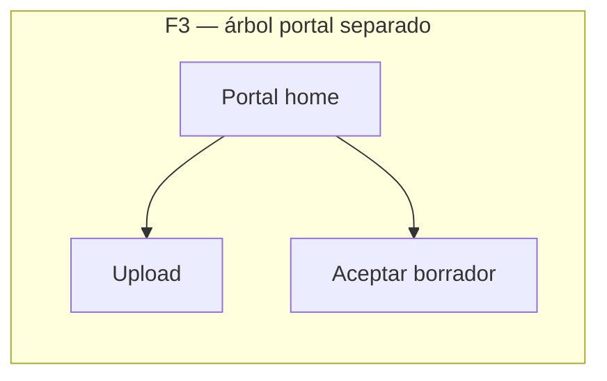

# Tribuvex — Information architecture / Sitemap (MN)

**Alcance:** Mediano Nuevo — app web del contador/revisor para **fase 0–1** (MVP asalariado: 7 etapas, PC1 / PC3 / PC5).  
**Fuera de este corte (anotado como F2/F3):** portal contribuyente (§16 abierto), cola de riesgo avanzada, lotes, PC2/PC4 UI completa, admin plataforma.  
**Overrides UI:** `pages/dashboard.md`, `expediente.md`, `checkpoint.md`.  
**PRD:** roles §3, grafo §8–10, fases §15, RNF-02 roles.

Breadcrumbs cuando profundidad ≥ 3 (p. ej. Expedientes → Cliente → Etapa → PC). Nav lateral sticky con offset de contenido (`pages/dashboard`).

---

## Mapa visual (MN)

---

## Inventario de nodos

| ID | Nodo | Ruta sugerida | Nivel | Nav | Roles | Fase | Page override |
|----|------|---------------|-------|-----|-------|------|---------------|
| A1 | Login | `/login` | 0 | — | todos | 1 | — |
| A2 | Dashboard expedientes | `/app` | 1 | Primary | preparador, revisor, admin* | 1 | `dashboard.md` |
| A3 | Clientes | `/app/clientes` | 1 | Primary | preparador, admin | 1 | — |
| A4 | Lista expedientes | `/app/expedientes` | 1 | Primary (o tab en A2) | preparador, revisor | 1 | `dashboard.md` |
| A5 | Nuevo expediente | `/app/expedientes/nuevo` | 2 | CTA desde A2/A4 | preparador | 1 | — |
| A6 | Expediente workspace | `/app/expedientes/:id` | 2 | — | preparador, revisor | 1 | `expediente.md` |
| E1–E7 | Etapas del grafo | `/app/expedientes/:id?etapa=1..7` | 3 | Stepper in-page | preparador, revisor (RO) | 1 | `expediente.md` |
| PC1 | Checkpoint ruta | modal/ruta interrupt | 4 | No nav | preparador | 1 | `checkpoint.md` |
| PC3 | Checkpoint depuración | idem | 4 | No nav | preparador | 1 | `checkpoint.md` |
| PC5 | Checkpoint borrador | idem | 4 | No nav | preparador; revisor si riesgo | 1 | `checkpoint.md` |
| A7 | Bitácora | `/app/expedientes/:id/bitacora` | 3 | Secondary / tab | preparador, revisor | 1 | — |
| A8 | Traza casilla | panel en A6 o `/.../traza/:casilla` | 3–4 | In-context | preparador, revisor | 1 | `expediente.md` |
| A9 | Paquete | `/app/expedientes/:id/paquete` | 3 | Tras PC5 | preparador, revisor | 1 | — |
| A10 | Admin entidad | `/app/admin` | 1 | Primary si rol | administrador (+ independiente) | 1 mínimo† | — |

\*Admin puede ver dashboard operativo según permiso.  
†Admin MN: usuarios + clientes; retención/exportación puede ser stub en F1.

**Contador independiente:** misma IA; A10 + roles preparador/revisor colapsados en un solo usuario (PRD §3).

---

## Navegación

### Primary (sidebar `bg-sidebar`)

1. Expedientes (A2/A4) — default landing post-login  
2. Clientes (A3)  
3. Administración (A10) — solo rol admin  

**No** en primary: etapas E1–E7, PCs, traza (viven dentro del expediente).

### In-expediente

- Stepper E1→E7 (estado done / current / locked / risk)  
- Tabs o secondary: Resumen · Soportes · Cédulas · Liquidación · Bitácora · Paquete  
- CTA contextual: Pausar · Ver bitácora · (nunca “Presentar en MUISCA”)

### Breadcrumbs

`Expedientes / {Cliente} / AG {año} / {Etapa}`  
Si hay PC abierto: `… / {Etapa} / PC{n}`

---

## Relaciones y reglas

| Relación | Regla |
|----------|--------|
| Cliente → Expedientes | Un cliente tiene 0..n expedientes (uno por año gravable típico) |
| Expediente → Etapas | Orden fijo B1; no se salta etapa con efecto sin PC/aprobación |
| Etapa → PC | PC interrumpe; no es página hermana permanente en el sitemap de nav |
| PC omitido | PC2/PC4 (F2): si no hay diferencias, no hay nodo UI; solo entrada en bitácora |
| Fuera de alcance | Desde PC1/E1 → estado “Derivado a manual” (terminal suave, sin E7 paquete automático) |
| Revisor | Entra por A2 filtrado “Pendiente revisor” / riesgo; foco PC5; bitácora RO+aprobar |
| Multitenencia | Ningún nodo cruza entidades; tenant del token (RNF-01) |

---

## Excepciones de IA

| Caso | Comportamiento en el mapa |
|------|---------------------------|
| Expediente pausado | A6 accesible; stepper muestra etapa actual; deep link conserva estado |
| Sesión expirada | Vuelta a A1; returnUrl a A6 si seguro |
| Sin permiso de cliente | 403 / empty state; no filtrar en silencio datos ajenos |
| Modelo caído | A6 operable: motor + expediente; banner degradación (RNF-10) — no nuevo nodo |
| Paquete sin PC5 | A9 no disponible / disabled con explicación |

---

## Fuera de MN (ampliación sitemap)

| ID | Nodo | Fase | Nota |
|----|------|------|------|
| PC2 | Cruce exógena | 2 | Mismo patrón `checkpoint.md` |
| PC4 | Patrimonio | 2 | Incluye aceptación de riesgo escrita |
| A11 | Cola de riesgo / lotes | 3 | Primary para revisor en temporada |
| A12 | Extemporánea / corrección | 3 | Entrada desde A5 o A6 · mockup `mockup/extemporanea.html` |
| P1 | Portal contribuyente — home | 3 | Árbol **separado** (sin sidebar contador); §16 |
| P2 | Portal — upload / faltantes | 3 | `portal-contribuyente.md` |
| P3 | Portal — aceptar borrador | 3 | |
| OP | Operador plataforma | post | Alta/suspende entidades; sin datos tributarios |

---

## Matriz rol × nodos (MN)

| Nodo | Preparador | Revisor | Admin entidad | Contribuyente |
|------|------------|---------|---------------|---------------|
| A1–A2 | ✓ | ✓ | ✓ | — (portal F3) |
| A3–A5 | ✓ | RO lista | ✓ clientes | — |
| A6 E1–E7 | ✓ | RO + PC5 | — | — |
| PC1 PC3 | ✓ | — / RO | — | — |
| PC5 | ✓ | ✓ si riesgo | — | — |
| A7–A9 | ✓ | ✓ | — | — |
| A10 | —※ | — | ✓ | — |

※Contador independiente: sí (todos los roles).

---

## Criterio de salida (sitemap MN)

- [ ] Todo RF de UI fase 1 mapea a un nodo o a un estado de A6/PC  
- [ ] Ningún ítem de nav viola “PC no es destino de menú”  
- [ ] Portal no aparece en primary hasta decisión §16  
- [ ] Profundidad máxima nav formal ≤ 3; etapas/PC son in-page  
- [ ] Revisado contra `ENTREGABLES_UX.md` fase 0–1  

## Next step

Flows MVP listos en `ux/flows/`. Seguir con content model o wireframes.
