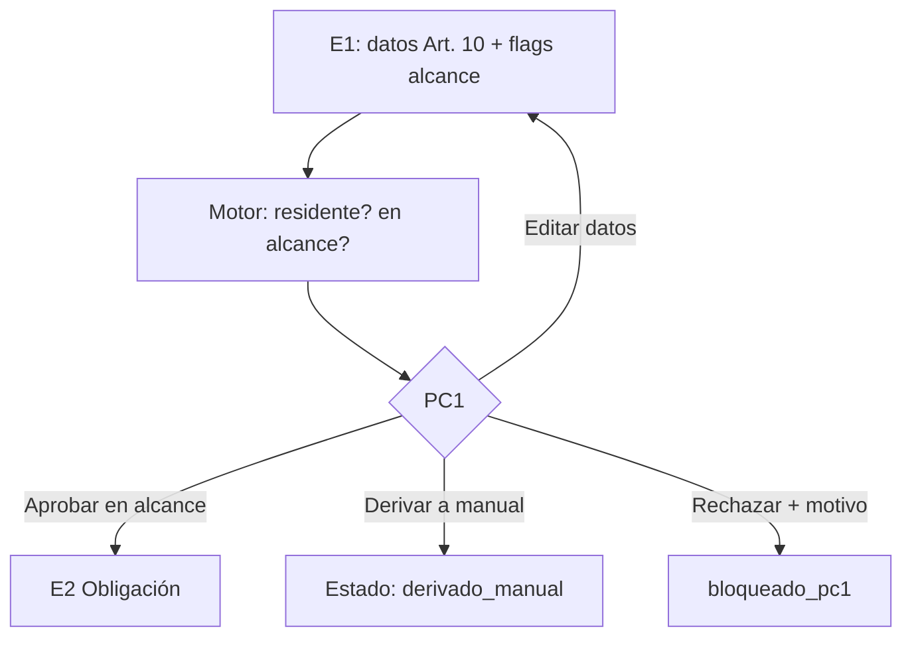

# F-02 — PC1 Ruta y alcance

**Objetivo:** Confirmar residencia, obligación preliminar y que el caso está en alcance (Formulario 210) antes de invertir en soportes.  
**Actor:** Contador preparador.  
**PRD:** §10 PC1, RF-01, RF-02, RF-22.  
**Sitemap:** E1 → PC1 (interrupt).  
**UI:** `pages/checkpoint.md` · preview pattern `checkpoint-preview.html`.  
**Diagrama:** ver también `PUNTOS_DE_CONTROL.md` → sección PC1.  
**Wireflow:** [`../wireflows/WF-02-pc1.html`](../wireflows/WF-02-pc1.html).

---

## Diagrama

---

## Trigger

El nodo Admisión termina de evaluar Art. 10 / obligación inicial / flags de fuera de alcance y el grafo llama `interrupt()` → se abre PC1.

---

## Pasos

| # | Quién | Qué | UI |
|---|-------|-----|-----|
| 1 | Sistema | Congela escritura de ruta; muestra resumen | Dialog/panel PC1 |
| 2 | Contador | Lee conclusión: residente sí/no, datos usados, alertas de alcance | Summary |
| 3 | Contador | Elige decisión | Footer Aprobar · Editar · Rechazar |
| 4a | Contador | **Aprobar** | Bitácora + resume → E2 |
| 4b | Contador | **Editar** | Form de datos Art. 10 / flags; motor reevalúa; vuelve a PC1 |
| 4c | Contador | **Rechazar** (+ motivo) | Etapa no cierra; expediente en revisión / parado |
| 4d | Contador | **Derivar a manual** (si fuera de alcance) | Estado “Derivado”; sin pipeline completo |

---

## Decisiones humanas

| Opción | Cuándo | Estado final parcial |
|--------|--------|----------------------|
| Aprobar | Conclusión correcta y en alcance | Ruta fijada; E2 |
| Editar | Dato mal capturado (días, etc.) | Interrupt activo hasta nueva conclusión |
| Rechazar | No confía / quiere parar | Sin avance; motivo en bitácora |
| Derivar | 110, sucesión, régimen simple, contabilidad, exterior… | Terminal suave MVP |

---

## Sistema

- Motor concluye residencia/obligación; agente solo presenta y pregunta.  
- Sin aprobación = ningún dato de ruta persistido como definitivo.  
- Transacción: decisión + bitácora + estado + orden de resume.

---

## Errores

| Error | UX |
|-------|-----|
| Rechazar sin motivo | `role="alert"` summary + campo motivo |
| Modelo no disponible | Mostrar inputs + resultado motor si existe; banner degradación |
| Conflicto de versión | “Otro cambio en el expediente”; recargar resumen PC1 |

---

## Alternativas

- Declaración voluntaria si no obligado: se decide en E2 tras PC1 aprobado con flag “no obligado” (RF-03), no sustituye PC1.  
- Contador independiente: misma UI.

---

## Estado final

| Resultado | Expediente |
|-----------|------------|
| Aprobado en alcance | E2 Obligación |
| Derivado | `derivado_manual` + bitácora |
| Rechazado | `bloqueado_pc1` hasta nueva acción |
