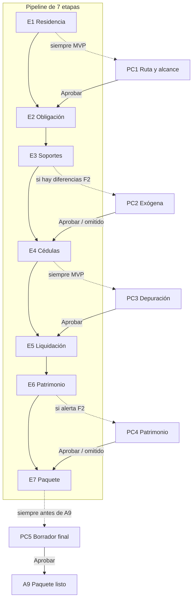
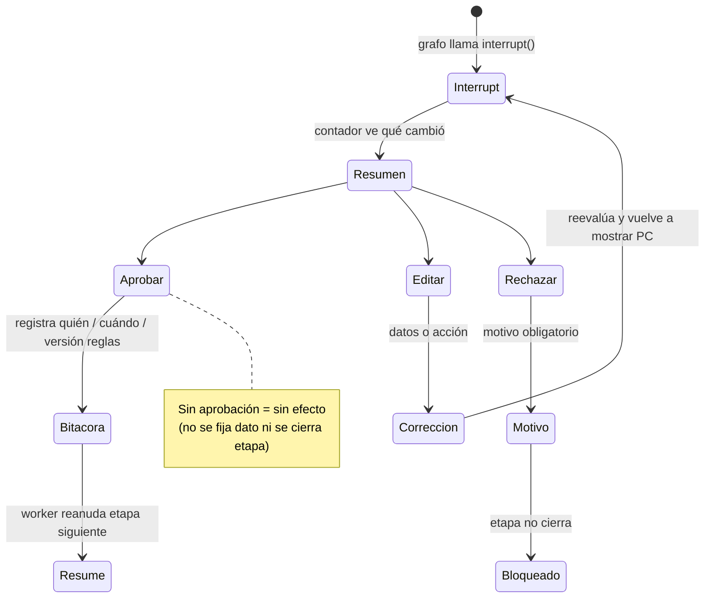
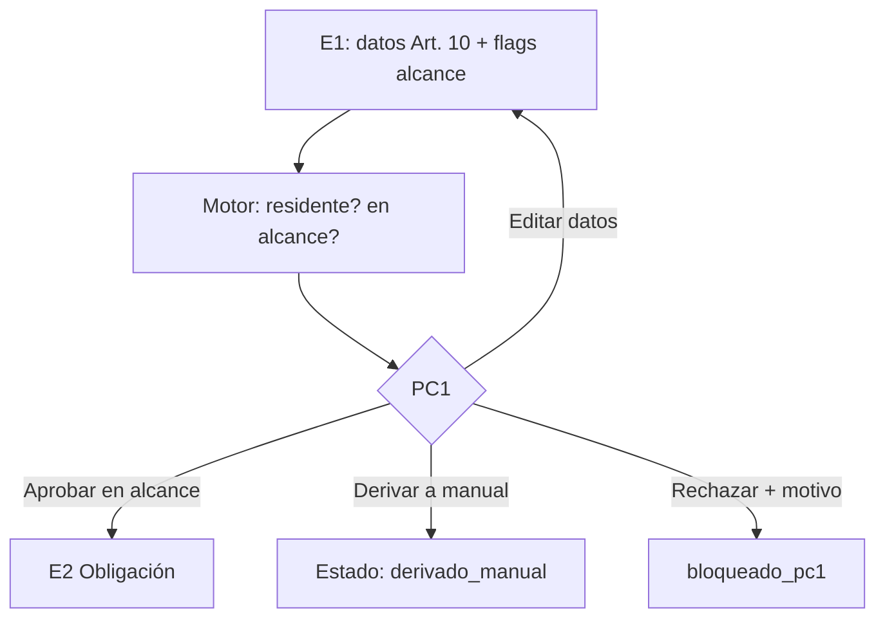
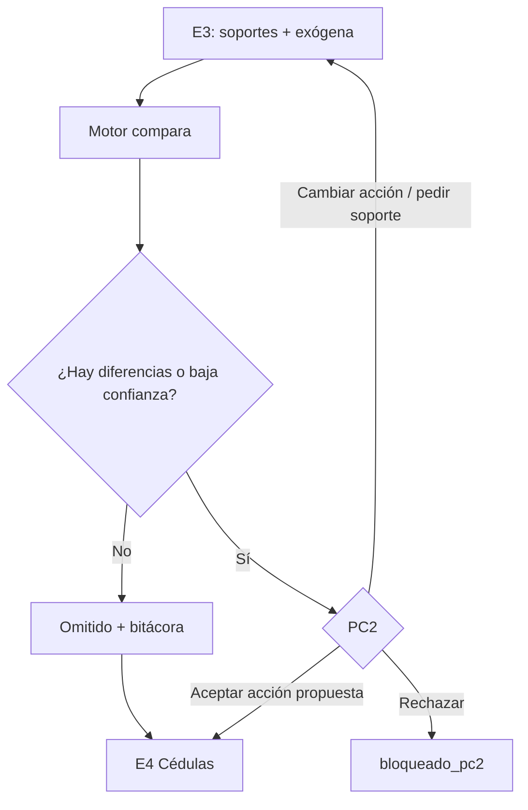
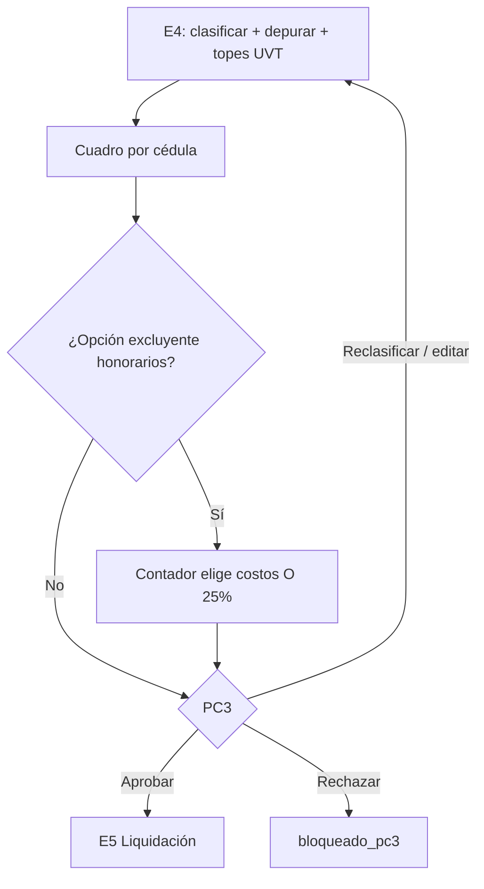
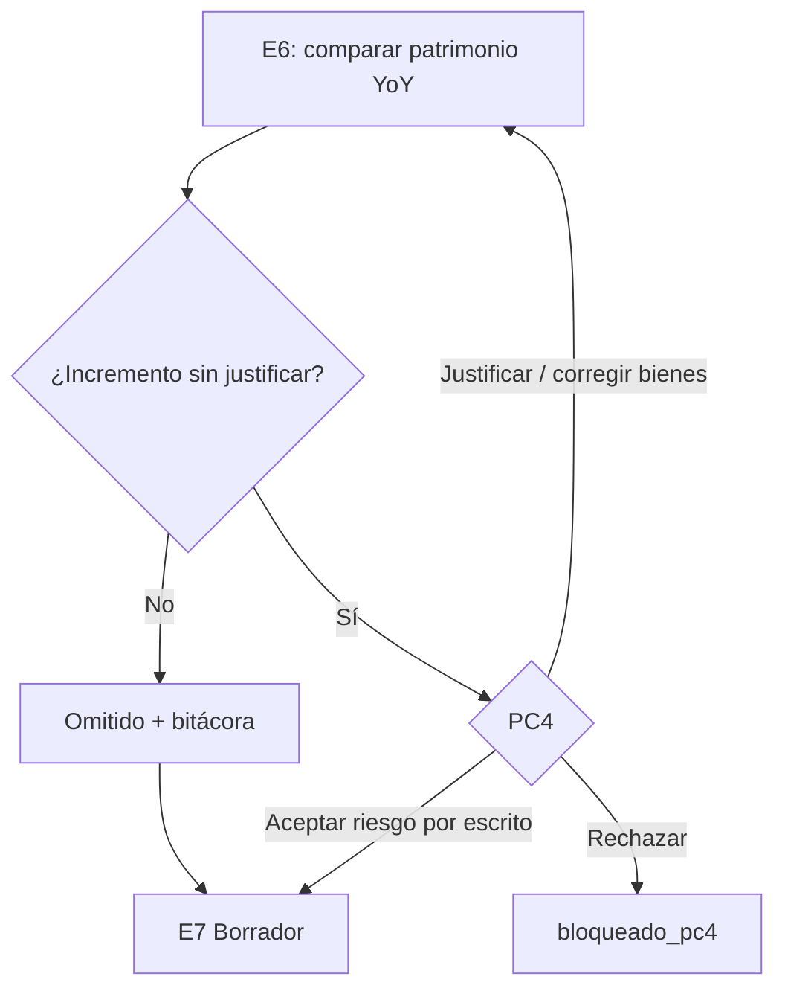
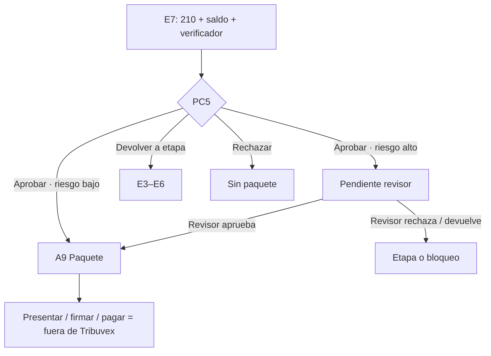

# Puntos de control (PC) — diagramas

**PC** = interrupción humana: el grafo se detiene hasta **Aprobar**, **Editar** o **Rechazar**.  
No son pantallas del menú; se abren sobre el expediente (`pages/checkpoint.md`).

---

## Mapa: etapas vs puntos de control

| PC | Fase UI | ¿Obligatorio abrir? |
|----|---------|---------------------|
| PC1 | 1 | Sí, tras E1 |
| PC2 | 2 | Solo si hay diferencias; si no → omitido + bitácora |
| PC3 | 1 | Sí, tras E4 |
| PC4 | 2 | Solo si hay alerta patrimonial; si no → omitido |
| PC5 | 1 | Sí, antes del paquete |

---

## Decisión genérica en cualquier PC

---

## PC1 — Ruta y alcance

Detalle narrativo: `02-pc1-ruta.md`

---

## PC2 — Cruce con exógena (F2)

---

## PC3 — Depuración

Detalle: `03-pc3-depuracion.md`

---

## PC4 — Patrimonio (F2)

---

## PC5 — Borrador final

Detalle: `04-pc5-borrador.md`

---

## Cómo verlos

En VS Code / Cursor / GitHub los bloques `mermaid` se renderizan en la vista previa Markdown.  
Si no se ven: extensión “Markdown Preview Mermaid Support” o pegar el código en [mermaid.live](https://mermaid.live).
