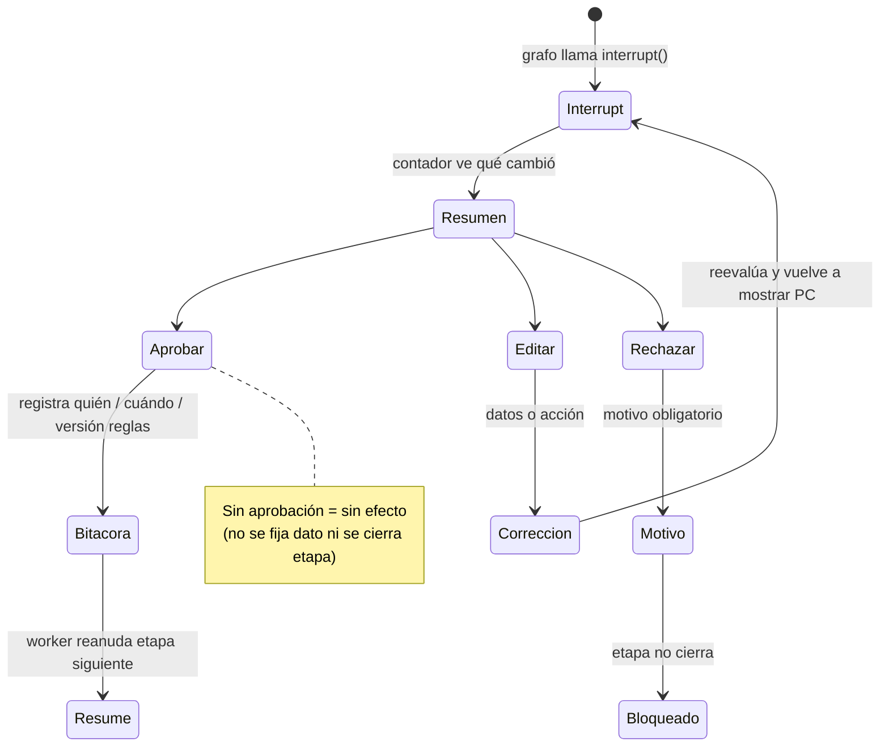

# Controles — diagramas

**Control** (id técnico `pcN`) = interrupción humana: el grafo se detiene hasta **Aprobar**, **Editar** o **Rechazar**.  
En UI se dice **Control 1…5**, no “PC”.  
No son pantallas del menú; se abren sobre el expediente (`pages/checkpoint.md`).

---

## Mapa: etapas vs controles

```mermaid
flowchart TB
  subgraph pipeline [Pipeline de 7 etapas]
    E1[E1 Residencia]
    E2[E2 Obligación]
    E3[E3 Soportes]
    E4[E4 Cédulas]
    E5[E5 Liquidación]
    E6[E6 Patrimonio]
    E7[E7 Paquete]
    E1 --> E2 --> E3 --> E4 --> E5 --> E6 --> E7
  end

  E1 -.->|siempre MVP| Control 1[Control 1 Ruta y alcance]
  E3 -.->|si hay diferencias F2| Control 2[Control 2 Exógena]
  E4 -.->|siempre MVP| Control 3[Control 3 Depuración]
  E6 -.->|si alerta F2| Control 4[Control 4 Patrimonio]
  E7 -.->|siempre antes de A9| Control 5[Control 5 Borrador final]

  Control 1 -->|Aprobar| E2
  Control 2 -->|Aprobar / omitido| E4
  Control 3 -->|Aprobar| E5
  Control 4 -->|Aprobar / omitido| E7
  Control 5 -->|Aprobar| A9[A9 Paquete listo]
```

| PC | Fase UI | ¿Obligatorio abrir? |
|----|---------|---------------------|
| Control 1 | 1 | Sí, tras E1 |
| Control 2 | 2 | Solo si hay diferencias; si no → omitido + bitácora |
| Control 3 | 1 | Sí, tras E4 |
| Control 4 | 2 | Solo si hay alerta patrimonial; si no → omitido |
| Control 5 | 1 | Sí, antes del paquete |

---

## Decisión genérica en cualquier PC



---

## Control 1 — Ruta y alcance

```mermaid
flowchart TD
  Start[E1: datos Art. 10 + flags alcance] --> Motor[Motor: residente? en alcance?]
  Motor --> Control 1{Control 1}
  Control 1 -->|Aprobar en alcance| E2[E2 Obligación]
  Control 1 -->|Editar datos| Start
  Control 1 -->|Derivar a manual| Der[Estado: derivado_manual]
  Control 1 -->|Rechazar + motivo| Stop[bloqueado_pc1]
```

Detalle narrativo: `02-pc1-ruta.md`

---

## Control 2 — Cruce con exógena (F2)

```mermaid
flowchart TD
  E3[E3: soportes + exógena] --> Cmp[Motor compara]
  Cmp --> Diff{¿Hay diferencias o baja confianza?}
  Diff -->|No| Omit[Omitido + bitácora]
  Omit --> E4[E4 Cédulas]
  Diff -->|Sí| Control 2{Control 2}
  Control 2 -->|Aceptar acción propuesta| E4
  Control 2 -->|Cambiar acción / pedir soporte| E3
  Control 2 -->|Rechazar| Stop[bloqueado_pc2]
```

---

## Control 3 — Depuración

```mermaid
flowchart TD
  E4[E4: clasificar + depurar + topes UVT] --> Cuadro[Cuadro por cédula]
  Cuadro --> Excl{¿Opción excluyente honorarios?}
  Excl -->|Sí| Elige[Contador elige costos O 25%]
  Excl -->|No| Control 3
  Elige --> Control 3{Control 3}
  Control 3 -->|Aprobar| E5[E5 Liquidación]
  Control 3 -->|Reclasificar / editar| E4
  Control 3 -->|Rechazar| Stop[bloqueado_pc3]
```

Detalle: `03-pc3-depuracion.md`

---

## Control 4 — Patrimonio (F2)

```mermaid
flowchart TD
  E6[E6: comparar patrimonio YoY] --> Alert{¿Incremento sin justificar?}
  Alert -->|No| Omit[Omitido + bitácora]
  Omit --> E7[E7 Borrador]
  Alert -->|Sí| Control 4{Control 4}
  Control 4 -->|Justificar / corregir bienes| E6
  Control 4 -->|Aceptar riesgo por escrito| E7
  Control 4 -->|Rechazar| Stop[bloqueado_pc4]
```

---

## Control 5 — Borrador final

```mermaid
flowchart TD
  E7[E7: 210 + saldo + verificador] --> Control 5{Control 5}
  Control 5 -->|Aprobar · riesgo bajo| A9[A9 Paquete]
  Control 5 -->|Aprobar · riesgo alto| Rev[Pendiente revisor]
  Rev -->|Revisor aprueba| A9
  Rev -->|Revisor rechaza / devuelve| Back[Etapa o bloqueo]
  Control 5 -->|Devolver a etapa| Etapa[E3–E6]
  Control 5 -->|Rechazar| Stop[Sin paquete]
  A9 --> Nota[Presentar / firmar / pagar = fuera de Tribuvex]
```

Detalle: `04-pc5-borrador.md`

---

## Cómo verlos

En VS Code / Cursor / GitHub los bloques `mermaid` se renderizan en la vista previa Markdown.  
Si no se ven: extensión “Markdown Preview Mermaid Support” o pegar el código en [mermaid.live](https://mermaid.live).
